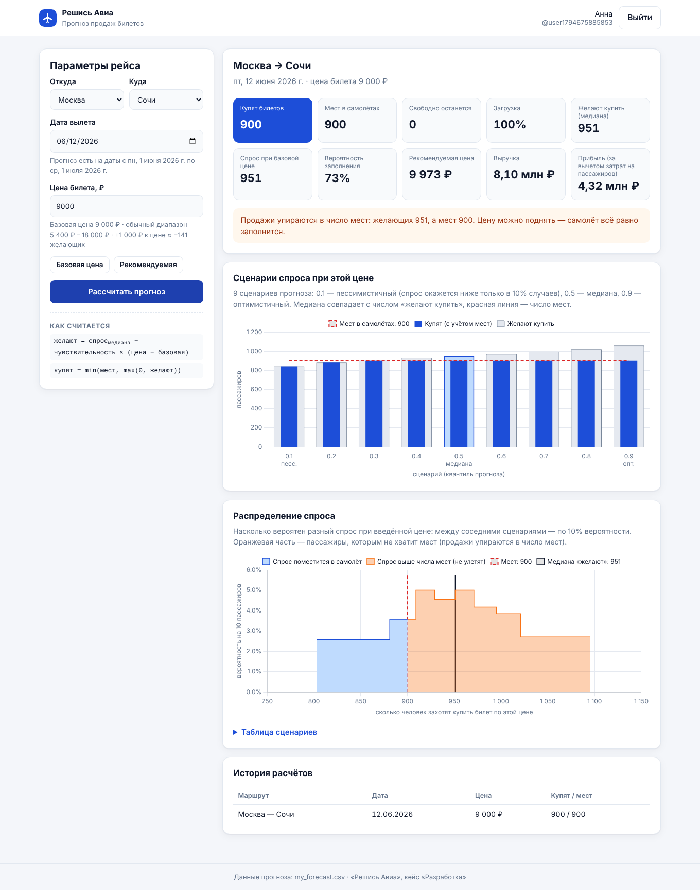

# Разработка: сервис прогноза продаж «Решись Авиа»

Сырой прогноз спроса из ML-части (`my_forecast.csv`) упакован в продукт: вводишь маршрут, дату и цену и сразу
видишь, сколько мест в самолёте, сколько билетов, скорее всего, купят и сколько мест останется свободными.

Реализован **вариант C** (веб-страница + backend API), все **дополнительные функции** и, для полноты, **вариант A** (скрипт).

Видеодемонстрация всех функций: [`demo/demo.mp4`](demo/demo.mp4) (1 минута; записана скриптом `demo/record_demo.cjs`).



| Требование кейса | Где реализовано |
|---|---|
| A. Скрипт «простое прогнозирование» | `cli.py` |
| B/C. Веб-страница с формой, логика/отправка на TypeScript | `frontend/src/*.ts` → `static/js/*.js`, `static/index.html` |
| C. Backend API, который считает прогноз | `app/main.py` (FastAPI), `app/forecast.py` |
| Доп. 1. График распределения спроса при введённой цене | 2 графика: сценарии 0.1–0.9 с линией мест и плотность распределения (Chart.js), + `cli.py --plot` |
| Доп. 2. Регистрация | `POST /api/auth/register`, вкладка «Регистрация» |
| Доп. 3. Авторизация | `POST /api/auth/login` / `logout`, сессия в HttpOnly-cookie; прогноз доступен только после входа |
| Доп. 4. Размещение на хостинге | `Dockerfile`, `docker-compose.yml`, инструкция ниже (образ собран и проверен локально) |
| Сверх списка | вероятность заполнения самолёта, рекомендуемая цена, выручка и прибыль, история расчётов, тёмная тема, мобильная вёрстка, тесты |

## Формула

```
желают = 0.5_base_demand − price_sensitivity × (цена − base_price)
купят  = min(seats, max(0, желают))
```

`0.5_base_demand` и `seats` берутся из строки рейса в файле прогноза, `base_price` и `price_sensitivity` — из `routes.csv`.
Для графика та же формула применяется к каждому из 9 сценариев (`0.1_base_demand` … `0.9_base_demand`): медиана
на графике совпадает с числом «желают», число мест отмечено красной линией. На графике плотности между соседними
сценариями лежит по 10% вероятности, а часть спроса правее числа мест выделена оранжевым: этим пассажирам мест не хватит.

Файл прогноза: по умолчанию `data/my_forecast.csv` (результат ML-части), если его нет — `data/seasonal_forecast.csv`
(заглушка из кейса). Другой файл можно указать переменной окружения `FORECAST_CSV`.

## Структура

```
dev/
├── app/
│   ├── forecast.py   # загрузка CSV и расчёт прогноза (общий для CLI и API)
│   ├── auth.py       # регистрация/вход: пароли scrypt + соль, серверные сессии, защита от перебора
│   ├── db.py         # SQLite: пользователи, сессии, история запросов
│   └── main.py       # FastAPI: REST API + раздача веб-страницы
├── frontend/         # исходники фронтенда на TypeScript (tsc → static/js)
├── static/           # index.html, styles.css, собранный JS, Chart.js
├── data/             # my_forecast.csv, seasonal_forecast.csv, routes.csv
├── tests/            # pytest: формула, ошибки ввода, регистрация/вход, API
├── cli.py            # вариант A
├── Dockerfile, docker-compose.yml
└── requirements.txt
```

## Запуск локально

```bash
cd dev
python -m venv .venv && source .venv/bin/activate
pip install -r requirements-dev.txt
uvicorn app.main:app --reload
```

Откройте <http://localhost:8000>, зарегистрируйтесь и введите параметры рейса. Документация API (Swagger) — <http://localhost:8000/docs>.

Фронтенд уже собран (`static/js`). Пересобрать после правок в `frontend/src`:

```bash
cd dev/frontend && npm ci && npm run build
```

### Вариант A — скрипт

```bash
cd dev
python cli.py --from Москва --to Сочи --date 2026-06-12 --price 9000
python cli.py --from MOW --to LED --date 2026-06-11 --price 7000 --plot chart.png   # с графиком
python cli.py                                                                       # интерактивный ввод
```

### Тесты

```bash
cd dev && python -m pytest -q
```

## API

| Метод | Путь | Описание |
|---|---|---|
| GET | `/api/meta` | маршруты, диапазон дат, имя файла прогноза |
| POST | `/api/auth/register` | `{login, name, password}` → создаёт пользователя и сразу входит |
| POST | `/api/auth/login` | `{login, password}` → cookie сессии |
| POST | `/api/auth/logout` | выход |
| GET | `/api/auth/me` | текущий пользователь (или `null`) |
| POST | `/api/forecast` | `{origin, destination, date, price}` → места, «желают», «купят», 9 сценариев (нужен вход) |
| GET | `/api/history` | последние 20 расчётов пользователя (нужен вход) |

Пример ответа `/api/forecast` (сокращённо; Москва — Сочи, 12.06.2026, 9 000 ₽, файл `seasonal_forecast.csv`):

```json
{"seats": 900, "wanted": 970.0, "sold": 900, "free_seats": 0, "load_factor": 1.0,
 "recommended_price": 10039, "sellout_probability": {"p": 0.71, "bound": "eq"},
 "scenarios": [{"quantile": 0.1, "base_demand": 822, "wanted": 822.0, "sold": 822}, "..."]}
```

## Размещение на хостинге

Приложение собирается в один Docker-образ (фронтенд собирается внутри, итоговый образ — Python + FastAPI):

```bash
cd dev
docker compose up -d --build      # сайт на http://<сервер>:8000
```

**TimeWeb Cloud.** Вариант 1 — «Apps» (App Platform): подключить GitHub-репозиторий, тип «Dockerfile», директория
`dev`, порт `8000`. Вариант 2 — облачный сервер (VPS) с Docker: склонировать репозиторий и выполнить команду выше.
Если сайт работает по HTTPS, задайте переменную окружения `COOKIE_SECURE=1`. База пользователей хранится в томе `/data`.

## Безопасность

- пароли хранятся только в виде хэша scrypt с солью; токен сессии — 256 бит, в базе хранится его SHA-256;
- cookie сессии `HttpOnly`, `SameSite=Lax` (и `Secure` при `COOKIE_SECURE=1`), срок 7 дней;
- ограничение перебора паролей: 10 неудачных попыток за 5 минут;
- заголовки `Content-Security-Policy`, `X-Frame-Options`, `X-Content-Type-Options`;
- все входные данные проверяются и на клиенте, и на сервере (pydantic + проверки в `forecast.py`).

## Использованные инструменты ИИ

Продукт разработан с помощью ИИ-агента **Claude Code** (Anthropic): проектирование, код backend и frontend,
тесты, вёрстка и проверка в браузере (Playwright).

Стек: Python 3.12, FastAPI, SQLite, TypeScript 5.9, Chart.js 4.5, Docker.
